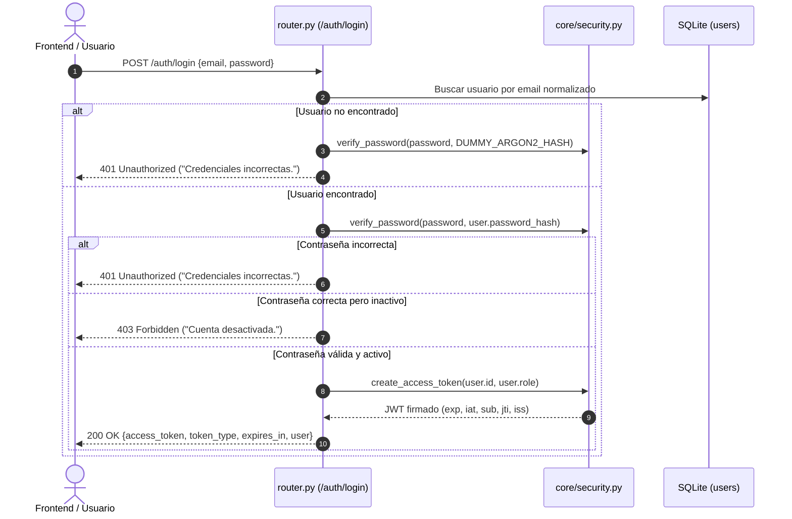
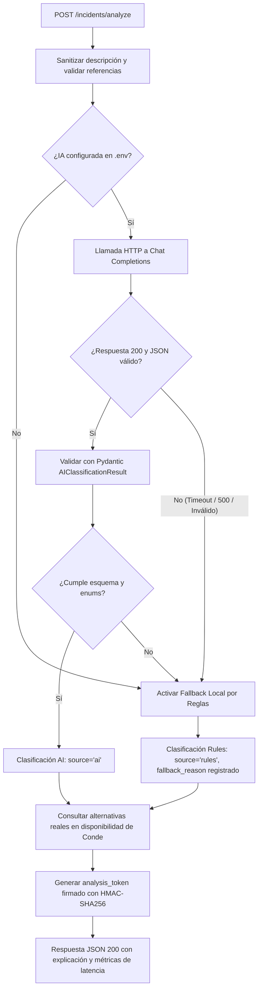

# Arquitectura de Seguridad, Autenticación, Incidencias e Inteligencia Artificial

**Responsable:** Diego  
**Alcance:** Historias de Usuario HU-11 a HU-16  
**Tecnologías:** FastAPI, Argon2id (`argon2-cffi`), PyJWT, Pydantic v2, SQLAlchemy 2.x, SQLite, HTTPX.

---

## 1. Arquitectura y Componentes Implementados

```text
backend/app/
├── core/
│   ├── config.py             # Configuración central (Pydantic Settings) y fail-fast
│   ├── exceptions.py         # Excepciones custom y manejadores globales uniformes
│   ├── security.py           # Argon2id, JWT con validación estricta y tokens de análisis
│   └── permissions.py        # Matriz centralizada ROLE_PERMISSIONS y dependencias FastAPI
├── db/
│   ├── base.py               # DeclarativeBase común (Base)
│   └── session.py            # Engine SQLite con PRAGMA foreign_keys=ON y get_db
├── modules/
│   ├── auth/
│   │   ├── enums.py          # Enum Role (admin, teacher, support)
│   │   ├── models.py         # Modelo User
│   │   ├── schemas.py        # Pydantic v2 schemas con validación de contraseñas y extra='ignore'
│   │   ├── service.py        # AuthService (hash Argon2, login tiempo constante, gestión de admin)
│   │   ├── router.py         # POST /auth/register, POST /auth/login, GET /auth/me
│   │   └── users_router.py   # GET /users, PATCH /users/{id}/role, PATCH /users/{id}/status
│   ├── incidents/
│   │   ├── enums.py          # Enums de categoría, prioridad, estado, equipo y fuente
│   │   ├── models.py         # Modelos Incident e IncidentEvent
│   │   ├── schemas.py        # Esquemas de entrada/salida y análisis
│   │   ├── service.py        # IncidentService (reglas de dominio, transiciones, disponibilidad)
│   │   └── router.py         # Endpoints de incidencias y análisis
│   └── recommendations/
│       ├── classifier_rules.py # Diccionario KEYWORD_RULES y clasificador determinista
│       ├── ai/provider.py     # Adaptador Chat Completions con defensa de prompt injection
│       └── service.py         # RecommendationService (orquestación IA -> Fallback -> Alternativas)
├── services/
│   ├── availability.py       # Punto de integración con Conde (salas oficiales y alternativas)
│   └── resources.py          # Punto de integración con Mayorga (recursos y alternativas)
└── scripts/
    └── create_admin.py       # Comando CLI de inicialización idempotente de administrador
```

---

## 2. Flujo de Autenticación y Autorización



### Seguridad Crítica en Peticiones Protegidas:
En cada endpoint protegido (`get_current_user`), el backend **no confía ciegamente en el rol firmado en el token**: recarga al usuario desde la base de datos para verificar su rol y estado activo en tiempo real. Si un administrador degrada o desactiva a un usuario, este pierde acceso inmediatamente en su siguiente petición sin esperar a que expire el JWT.

---

## 3. Flujo de Clasificación con IA y Fallback Local



---

## 4. Dónde Modificar Reglas en Vivo (< 3 Minutos)

Para la sustentación frente al jurado, cualquier cambio de regla se encuentra centralizado en un archivo y constante único:

1. **Permisos y roles (`backend/app/core/permissions.py`):**
   - Modificar la constante `ROLE_PERMISSIONS`:
     - Ejemplo: Permitir que `support` pueda reservar salas agregando `"reserve_space"` a su conjunto.
2. **Categorías que bloquean disponibilidad (`backend/app/modules/incidents/service.py`):**
   - Modificar el conjunto `BLOCKING_CATEGORIES`:
     - Ejemplo: Agregar `IncidentCategory.TECHNOLOGY` para que fallas en proyectores inhabiliten salas.
3. **Palabras clave y heurística de IA Fallback (`backend/app/modules/recommendations/classifier_rules.py`):**
   - Modificar el diccionario `KEYWORD_RULES`:
     - Ejemplo: Agregar palabras como `"gotera"`, `"pantalla"` o cambiar el umbral de criticidad.
4. **Política de robustez de contraseña (`backend/app/modules/auth/schemas.py`):**
   - Modificar `validate_password_strength` (ej. cambiar longitud mínima de 8 a 12 caracteres).

---

## 5. Demostración en Vivo para el Jurado

### Demostración 1: Probar que la IA es Real
1. Configurar el proveedor Groq en el `.env` local (ignorado por Git):
   ```dotenv
   AI_PROVIDER=groq
   AI_MODEL=llama-3.3-70b-versatile
   AI_API_KEY=<clave local de Groq>
   AI_BASE_URL=
   ```
   El adaptador selecciona `https://api.groq.com/openai/v1` automáticamente.
   Reiniciar `backend` para cargar los cambios de entorno. La clave no se incluye en commits.
2. Ejecutar petición en Swagger `/docs` a `POST /incidents/analyze`:
   ```json
   {
     "description": "Se escuchó una explosión en el tomacorriente del auditorio y sale humo denso.",
     "space_id": "SAL-001"
   }
   ```
3. **Evidencia que revisará el jurado:**
   - `"classification_source": "ai"`
   - `"ai_model": "llama-3.3-70b-versatile"`
   - `"latency_ms"` con la duración real de la petición
   - Categoría, prioridad y recomendación sujetas a la respuesta validada del modelo
   - `"analysis_token"` con firma HMAC válida.

### Demostración 2: Probar el Fallback Honesto sin IA
1. Simular caída o desconexión del proveedor quitando temporalmente `AI_API_KEY` del `.env` local y reiniciando `backend`:
   ```dotenv
   AI_API_KEY=
   ```
2. Ejecutar la misma petición a `POST /incidents/analyze`:
   ```json
   {
     "description": "El aire acondicionado gotea profusamente sobre el piso de Spooki.",
     "space_id": "SAL-004"
   }
   ```
3. **Evidencia que revisará el jurado:**
   - `"classification_source": "rules"` (**nunca simula ser IA**)
   - `"ai_model": null`
   - `"fallback_reason": "not_configured"`
   - `"explanation": "Regla activada por palabras clave coincidentes: aire, gotea, piso."`
   - La aplicación continuó operando sin interrumpir el flujo del campus.
