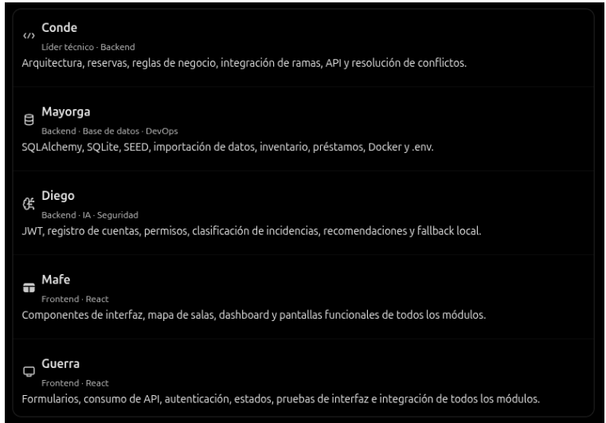

# Team Responsibilities and Work Breakdown

**Project:** Campus Control — Central Operating Management System  
**Hackathon:** Campuslands under Pressure (5 hours, 5 developers)

---

## 1. Overview and Responsibility Diagram

| Developer | Domain Area | Assigned Stories | Status | Downstream Consumers |
| :--- | :--- | :---: | :---: | :--- |
| **Conde** | Architecture, Backend & Spaces | HU-01 to HU-05 | HU-01 a HU-04 completados | Mafe, Guerra |
| **Mayorga** | Database, Inventory & DevOps | HU-06 to HU-10 | HU-06, 07, 08, 10 completados | Conde, Diego |
| **Diego** | Auth, Security, Incidents & AI | HU-11 to HU-16 | HU-11 a HU-16 completados (100%) | Guerra, Conde |
| **Mafe** | Frontend Visual & UI/UX | HU-17 to HU-20 | Frontend en desarrollo | Guerra |
| **Guerra** | Frontend Functional & Integration | HU-21 to HU-24 | Frontend en desarrollo | Mafe |

---

## 2. Detailed Work Breakdown by Member

### 2.1. Conde — Architecture, Backend & Space Management
- **HU-01 (P0) — FastAPI Initialization & Architecture:** Modular monolith setup, `/health` endpoint, standard JSON error formatting.
- **HU-02 (P0) — Space Availability Query:** `GET /spaces` checking occupancy, schedule conflicts, and room capacity across the 10 official rooms (`SAL-001` to `SAL-010`).
- **HU-03 (P0) — Space Reservations:** `POST /reservations` transactional creation preventing capacity overbooking and schedule overlap.
- **HU-04 (P1) — Reservation Modification & Cancellation:** Safe cancellation freeing up availability.
- **HU-05 (P1) — Relocation Proposals:** Deterministic alternative calculation for bookings affected by room closures.

### 2.2. Mayorga — Database, Inventory & DevOps
- **HU-06 (P0) — Database Persistence:** SQLAlchemy models, SQLite with `PRAGMA foreign_keys=ON`, volume persistence in Docker.
- **HU-07 (P0) — Reproducible SEED:** Idempotent database seeding for rooms, initial demo accounts (`admin`, `teacher`, `support`), sample bookings and incidents.
- **HU-08 (P0) — Technology Resources & Loans:** Device inventory, loan tracking, and status transitions.
- **HU-09 (P0) — Official Dataset Importer:** CSV/JSON dataset validator and importer.
- **HU-10 (P0) — Docker Compose Orchestration:** Full environment setup (`compose.yaml`) with healthchecks and isolated networking.

### 2.3. Diego — Authentication, Security, Incidents & AI Triage
- **HU-11 (P0) — Public Registration:** `POST /auth/register` with Argon2id password hashing, forced `teacher` role assignment, and privilege escalation defense.
- **HU-12 (P0) — Login & JWT Authentication:** `POST /auth/login` with timing-safe dummy hash comparison, strict PyJWT verification, and `GET /auth/me`.
- **HU-13 (P1) — Role-Based Access Control:** Centralized `ROLE_PERMISSIONS` matrix, `require_roles` dependencies, and user role/status management for admins.
- **HU-14 (P0) — Incident Management & Availability:** Full lifecycle tracking (`open` -> `in_progress` -> `resolved`), audit event history, and room blocking effects.
- **HU-15 (P0) — Intelligent AI Classification:** `POST /incidents/analyze` with ChatCompletions adapter, prompt injection defense, Pydantic validation, and signed `analysis_token`.
- **HU-16 (P1) — Deterministic Rules Fallback:** Keyword heuristic classification (`classification_source: "rules"`) when AI is unreachable, providing real recommendations without hallucinated inventory.

### 2.4. Mafe — Frontend Visual & Dashboard
- **HU-17 (P0) — Main Interface & Navigation:** Responsive layout, navigation bar, shared Tailwind theme.
- **HU-18 (P0) — Interactive Room Map:** Visual seat/room selection map showing real-time room availability and states.
- **HU-19 (P1) — Operational Dashboard:** Indicators for open incidents, room occupancy, and active loans.
- **HU-20 (P1) — Incident & Recommendation Visualizer:** Visual differentiation between AI suggestions and confirmed administrative actions.

### 2.5. Guerra — Frontend Functional & Integration
- **HU-21 (P0) — Authentication State & Session:** Login/register forms, JWT token storage, automatic logout on 401.
- **HU-22 (P0) — Integrated Reservation Form:** Interactive booking flow connected to `POST /reservations`.
- **HU-23 (P0) — Equipment Loan Management:** Requesting available tech resources and registering returns.
- **HU-24 (P0) — End-to-End Incident Flow:** Incident reporting connected to `/incidents/analyze` with relocation suggestions and admin confirmation.

---

## 3. Mandatory 2:30 Checkpoint

At the 2-hour-and-30-minute mark, the following flows must be working end-to-end with persistent SQLite storage:
1. User registration & login with JWT.
2. Space availability query & reservation.
3. Equipment loan tracking.
4. Incident creation, AI classification & status updates.

If any of these core flows fails, visual improvements are paused to stabilize persistence and integrations.
